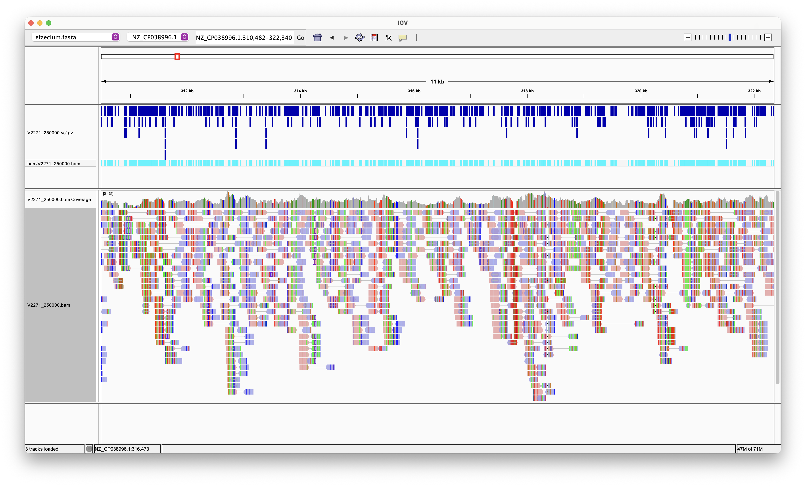
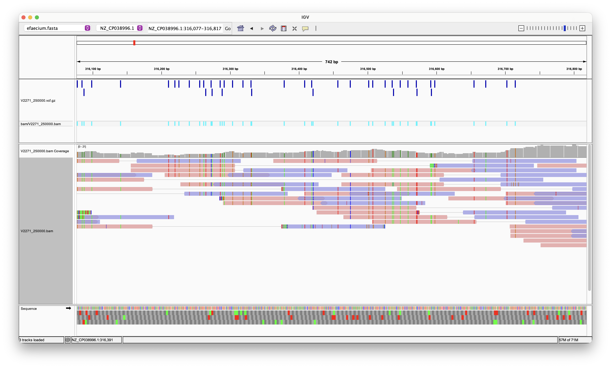
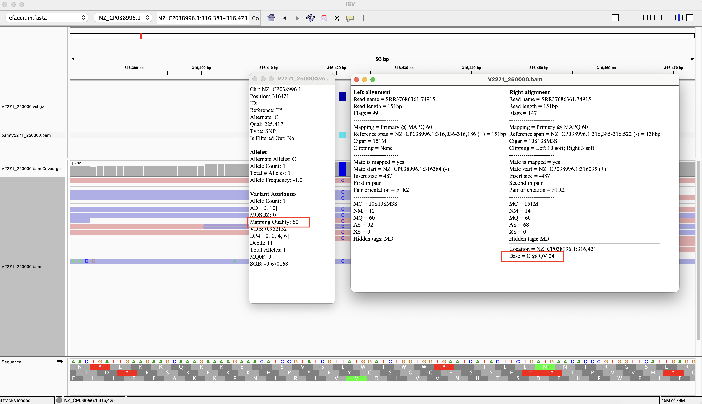
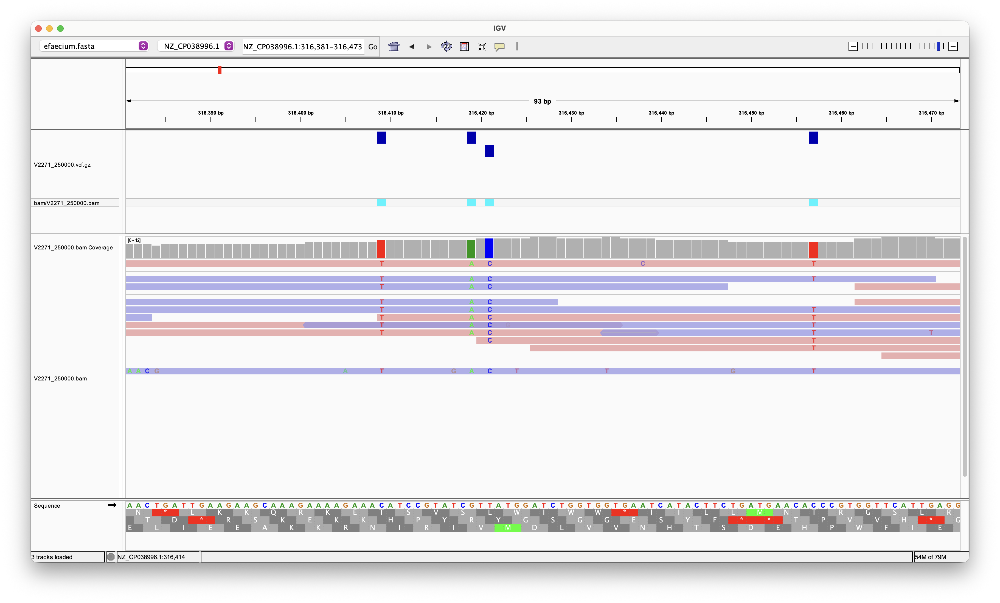
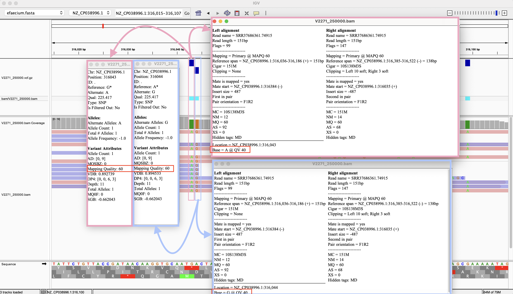

# Week 7 Assignment

## Sequencing Data and Reference Genome
For Week 5 assignment, I aligned paired-end reads from experiment [SRX32564595](https://www.ncbi.nlm.nih.gov/sra/SRX32564595[accn]) (run [ `SRR37686361`](https://trace.ncbi.nlm.nih.gov/Traces/?view=run_browser&acc=SRR37686361&display=metadata)), from [BioProject PRJNA1439525](https://www.ncbi.nlm.nih.gov/bioproject/PRJNA1439525), to *E. faecium* SSR24 reference genome [GCF_009734005.1](https://www.ncbi.nlm.nih.gov/datasets/genome/GCF_009734005.1/). I reused the same reference and aligned BAM file for this assignment.

In the previous assignment, 150,000 paired-end read pairs produced a chromosome mean depth of 7.56×. Assuming depth increased approximately in proportion to the number of read pairs, I estimated that about
198,000 pairs would be needed to reach 10×. I therefore selected 250,000 pairs to provide a margin above this estimate.

I confirmed coverage of the resulting BAM using:
```
samtools coverage bam/V2271_250000.bam
```
output:
```
#rname	startpos	endpos	numreads	covbases	coverage	meandepth	meanbaseq	meanmapq
NZ_CP038996.1	1	2796178	240994	2590270	92.6361	12.5801	38.3	53.6
NZ_CP038997.1	1	123020	67980	95659	77.7589	79.7978	38.4	55.5
```
The chromosome mean depth was 12.58×, which exceeds the assignment's 10× mean-depth target, so I used
this BAM for variant calling without increasing the number of reads.

In `Makefile`, I set `PLOIDY = 1` for variant calling, assuming the sample represents a single haploid bacterial strain.

## Results

### Variant calling results
I generated a statistics report for the VCF file using `bcftools stats`, through the following Makefile target:
```
make vcf-stats
```
The report was saved to `vcf/V2271_250000.vcf.gz.stats.txt`. I inspected its summary-number (`SN`) entries using:
```
awk '$1=="SN"' vcf/V2271_250000.vcf.gz.stats.txt
```
output:
```
SN	0	number of samples:	1
SN	0	number of records:	9162
SN	0	number of no-ALTs:	0
SN	0	number of SNPs:	9021
SN	0	number of MNPs:	0
SN	0	number of indels:	141
SN	0	number of others:	0
SN	0	number of multiallelic sites:	0
SN	0	number of multiallelic SNP sites:	0
```

### Number and types of variants
The report contained **9,162 variant records** for one sample. These consisted of **9,021 SNPs** and **141 indels**, as we can see from the output above. Indels in `bcftools` are insertions or deletions, and the count combines both insertions and deletions. No MNP records or multiallelic sites were reported. Most called variants were therefore SNPs.

## Visual inspection of variants in IGV
I first launched IGV and kept it running, and in a second terminal, I ran `make igv` to load the reference FASTA, aligned BAM, and VCF.


The region `NZ_CP038996.1:310,482–322,340` contained a dense cluster of variant calls and many mismatches between the reads and the reference.



I zoomed into `NZ_CP038996.1:316,077–316,817` to examine individual calls and their supporting alignments. Several mismatches appeared at corresponding positions across multiple reads, providing evidence of consistent sequence differences rather than isolated read errors.


At position `316,421`, a T-to-C SNP was called. The VCF reported `AD=[0,10]`, indicating no counted support for the reference `T` and 10 observations supporting the alternative `C`. `DP4=[0,0,4,6]` showed alternative-allele support in both forward and reverse reads. The selected read had mapping quality 60, while its C at this position had base quality 24.



I also inspected bases at nearby positions in the same region and observed additional base quality values of 24.


At positions `316,043` and `316,044`, G-to-A and A-to-G SNPs were called, respectively. Both records reported `AD=[0,9]` and `DP4=[0,0,6,3]`, showing alternative-allele support in both directions. The inspected bases at these positions had base quality 40, and the selected read had mapping quality 60. 

The G-to-A and A-to-G calls at positions `316,043` and `316,044` appear consistent with true variants. Each had 9 counted observations. The inspected bases had quality 40, and the selected read had mapping quality 60. The T-to-C call at position 316,421 also appears supported, with 10 counted observations supporting C and none supporting T. However, the inspected C had base quality 24, and additional nearby bases
also had quality 24. These observations provide weaker evidence than the quality-40 bases, but they are not sufficient to classify the calls as errors. The selected calls are supported by repeated alternative bases
across multiple alignments.


## Makefile Usage

By default, the Makefile processes the first 250,000 spots. To run the complete workflow, run:
```
make
```

Parameters can be overridden on the command line. For example:
```
make all N=500000
```

Individual targets can also be run separately:

| Target        | Function                                                                                                  |
| ------------- | --------------------------------------------------------------------------------------------------------- |
| `make genome` | Downloads and decompresses the reference genome FASTA file.                                               |
| `make fastq`  | Downloads the first `N` spots from `SRR37686361` and separates the paired-end reads into two FASTQ files. |
| `make index`  | Builds the BWA index for the reference genome.                                                            |
| `make align`  | Aligns the paired-end reads with `bwa mem`, then sorts and indexes the BAM file.                          |
| `make stats`  | Generates a `samtools flagstat` report for the BAM file.                                                  |
| `make variants`  | Calls variants from the BAM, normalizes and sorts the records, and creates a compressed VCF with a `.tbi` index.                                              |
| `make vcf-stats`  | Generates a variant statistics report using `bcftools stats`.                                            |
| `make igv`  | Loads the reference FASTA, BAM, and VCF into a running IGV instance.                                                    |
| `make clean`  | Deletes the `fasta`, `fastq`, `bam`, and `vcf` directories, including downloaded data and generated results.                    |
