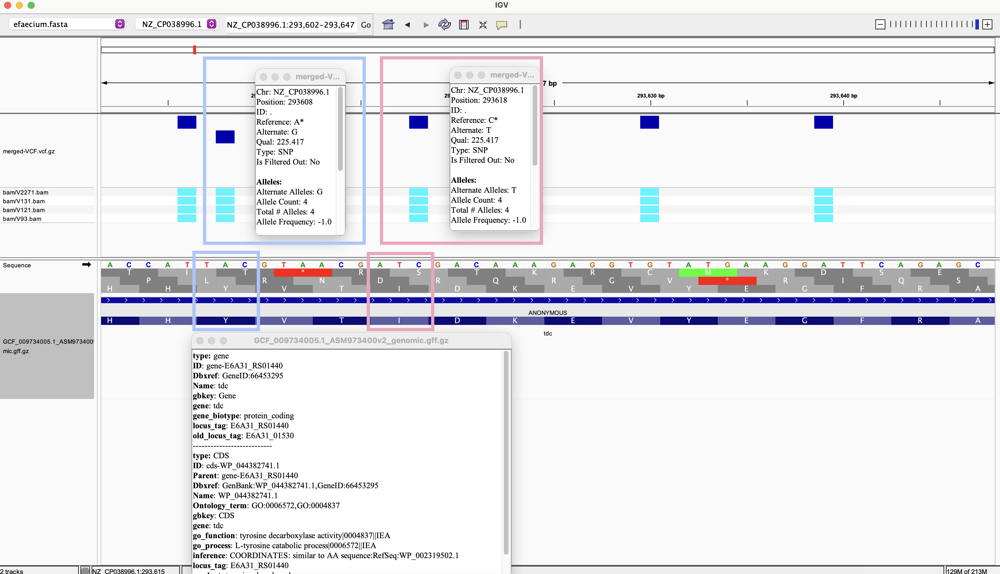
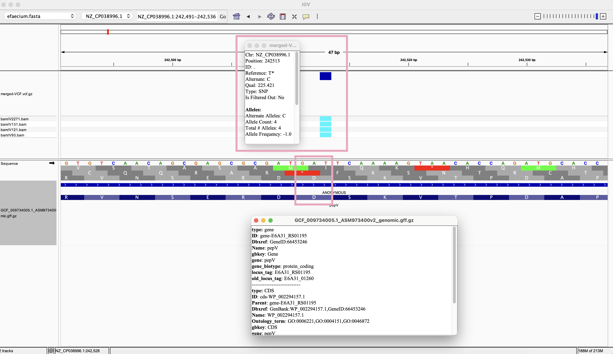
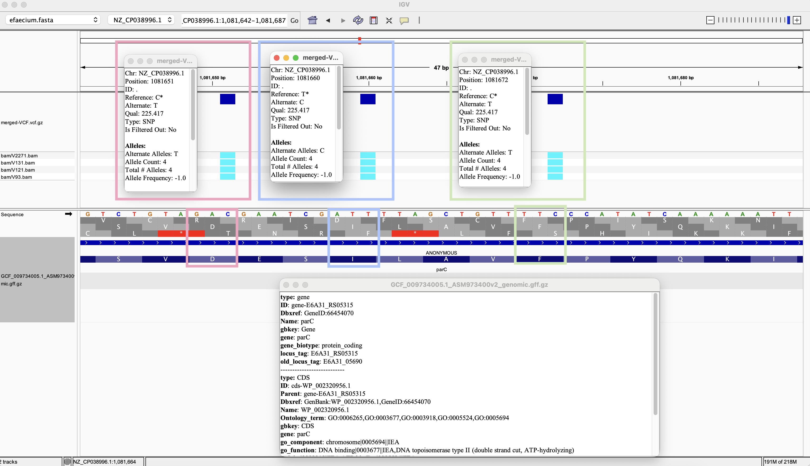
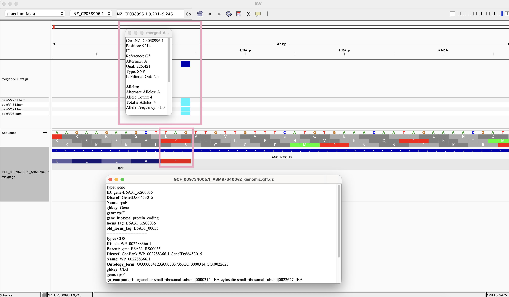

# Week 8 Assignment 

## Sequencing Data and Reference Genome
For Week 5 and 7 assignment, I aligned paired-end reads from [BioProject PRJNA1439525](https://www.ncbi.nlm.nih.gov/bioproject/PRJNA1439525), to *E. faecium* SSR24 reference genome [GCF_009734005.1](https://www.ncbi.nlm.nih.gov/datasets/genome/GCF_009734005.1/). I reused the same reference and aligned BAM file for this week's assignment.

For this week's assignment, I used the same reference genome and processed four samples separately using the Makefile. I then merged their VCF files into a single multisample VCF for variant effect prediction.

| Sample | SRA Run | SRA Experiment |
|---|---|---|
| V2271 | [SRR37686361](https://trace.ncbi.nlm.nih.gov/Traces/index.html?view=run_browser&acc=SRR37686361&display=metadata) | [SRX32564595](https://www.ncbi.nlm.nih.gov/sra/SRX32564595) |
| V131 | [SRR37686362](https://trace.ncbi.nlm.nih.gov/Traces/index.html?view=run_browser&acc=SRR37686362&display=metadata) | [SRX32564594](https://www.ncbi.nlm.nih.gov/sra/SRX32564594) |
| V121 | [SRR37686363](https://trace.ncbi.nlm.nih.gov/Traces/index.html?view=run_browser&acc=SRR37686363&display=metadata) | [SRX32564593](https://www.ncbi.nlm.nih.gov/sra/SRX32564593) |
| V93 | [SRR37686364](https://trace.ncbi.nlm.nih.gov/Traces/index.html?view=run_browser&acc=SRR37686364&display=metadata) | [SRX32564592](https://www.ncbi.nlm.nih.gov/sra/SRX32564593ㄴ) |


## Results
### Variant 1 in `tdc`


| Location | SNP | Reference codon → Alternate codon | Amino acid change | Predicted effect |
| -------- | -------- | -------- | -------- | -------- |
| 293608 | A → G | TAC → TGC | Tyr → Cys | Missense |
| 293618 | C → T | ATC → ATT | Ile → Ile | Synonymous |


### Variant 2 in `pepV`

| Location | SNP | Reference codon → Alternate codon | Amino acid change | Predicted effect |
| -------- | -------- | -------- | -------- | -------- |
| 242513 | T → C | GAT → GAC | Asp → Asp | Synonymous |


### Variant 3 in `parC`

| Location | SNP | Reference codon → Alternate codon | Amino acid change | Predicted effect |
| -------- | -------- | -------- | -------- | -------- |
| 1081651 | C → T | GAC → GAT | Asp → Asp | Synonymous |
| 1081660 | T → C | ATT → ATC | Ile → Ile | Synonymous |
| 1081672 | C → T | TTC → TTT | Phe → Phe | Synonymous |


### Variant 4 in `rpsF`

| Location | SNP | Reference codon → Alternate codon | Amino acid change | Predicted effect |
| -------- | -------- | -------- | -------- | -------- |
| 9214 | G → A | TAG → TAA | Stop → Stop | Synonymous |


### Confirming with snpEff
Since `snpEff` didn't have my reference genome, I asked ChatGPT (GPT-6.1 Sol Light) to build a custom `snpEff` database for my genome of interest. Commands that I used to do this can found [here](https://gist.github.com/amygchoi/9e635bcd6576c9a67bbcb42c51090d93).

To verify the predicted effect of the variant at position 1,081,651:
```
bcftools view -H annotated.vcf |
awk '$1=="NZ_CP038996.1" && ($2==1081651)'
```
Output:
```
> awk '$1=="NZ_CP038996.1" && ($2==1081651)'
[W::bcf_hdr_check_sanity] MQ should be declared as Type=Float
NZ_CP038996.1	1081651	.	C	T	225.417	.	VDB=0.0261047;SGB=-0.676189;MQSBZ=0;MQ0F=0;MQ=60;DP=65;DP4=0,0,40,20;AD=0,12;AN=4;AC=4;ANN=T|synonymous_variant|LOW|parC|gene-E6A31_RS05315|transcript|TRANSCRIPT_gene-E6A31_RS05315|protein_coding|1/1|c.1770C>T|p.Asp590Asp|1770/2451|1770/2451|590/816||,T|upstream_gene_variant|MODIFIER|plsY|gene-E6A31_RS05300|transcript|TRANSCRIPT_gene-E6A31_RS05300|protein_coding||c.-4553G>A|||||4553|,T|upstream_gene_variant|MODIFIER|pflB|gene-E6A31_RS05320|transcript|TRANSCRIPT_gene-E6A31_RS05320|protein_coding||c.-958C>T|||||958|,T|upstream_gene_variant|MODIFIER|pflA|gene-E6A31_RS05325|transcript|TRANSCRIPT_gene-E6A31_RS05325|protein_coding||c.-3433C>T|||||3433|,T|upstream_gene_variant|MODIFIER|E6A31_RS05330|gene-E6A31_RS05330|transcript|TRANSCRIPT_gene-E6A31_RS05330|protein_coding||c.-4279C>T|||||4279|,T|downstream_gene_variant|MODIFIER|E6A31_RS05305|gene-E6A31_RS05305|transcript|TRANSCRIPT_gene-E6A31_RS05305|protein_coding||c.*3992C>T|||||3992|,T|downstream_gene_variant|MODIFIER|parE|gene-E6A31_RS05310|transcript|TRANSCRIPT_gene-E6A31_RS05310|protein_coding||c.*1781C>T|||||1781|	GT:PL:DP:SP:ADF:ADR:AD:GQ	1:255,0:11:0:0,8:0,3:0,11:127	1:255,0:18:0:0,10:0,8:0,18:127	1:255,0:19:0:0,12:0,7:0,19:127	1:255,0:12:0:0,10:0,2:0,12:127
```
This confirms that the C-to-T substitution at position 1,081,651 is a synonymous variant in the parC gene, leaving aspartic acid at amino acid position 590 unchanged.


## Makefile Usage

By default, the Makefile processes the first 250,000 spots from SRR37686361 for sample V2271. To download reads, align them, call variants, and generate statistics, run:
```
make
```

Parameters can be overridden on the command line. For example, to process the first 500,000 spots:
```
make samples N=500000
```

To process all four samples, run:
```
make all SAMPLE_NAME=V2271 SRR=SRR37686361
make all SAMPLE_NAME=V131 SRR=SRR37686362
make all SAMPLE_NAME=V121 SRR=SRR37686363
make all SAMPLE_NAME=V93 SRR=SRR37686364
```

After processing all four samples with the same value of N, run either or both multi-sample analyses:
```
make merge-vcf
make joint-call
```
With the default N=250000, the output files are `vcf/merged-VCF_250000.vcf.gz` and `vcf/merged-BAM_250000.vcf.gz`.

Changing N creates separate FASTQ directories and sample output files. Changing other parameters does not automatically rebuild existing outputs.


Individual targets can also be run separately:

| Target        | Function                                                                                                  |
| ------------- | --------------------------------------------------------------------------------------------------------- |
| `make genome` | Downloads and decompresses the reference genome FASTA file.                                               |
| `make gff` | Downloads and decompresses the reference annotation GFF file.                                               |
| `make fastq`  | Downloads the first `N` spots from `SRR37686361` and separates the paired-end reads into two FASTQ files. |
| `make index`  | Builds the BWA index for the reference genome.                                                            |
| `make align`  | Aligns the paired-end reads with `bwa mem`, then sorts and indexes the BAM file.                          |
| `make stats`  | Generates a `samtools flagstat` report for the BAM file.                                                  |
| `make variants`  | Calls variants from the BAM, normalizes and sorts the records, and creates a compressed VCF with a `.tbi` index.                                              |
| `make vcf-stats`  | Generates a variant statistics report using `bcftools stats`.                                            |
| `make merge-vcf`  | Merges the four existing sample VCFs into `vcf/merged-VCF_$(N).vcf.gz` and creates an index.                                                    |
| `make joint-call`  | Jointly calls variants from the four existing sample BAMs, producing `vcf/merged-BAM_$(N).vcf.gz` and an index.                                                    |
| `make clean`  | Deletes the `fasta`, `fastq`, `bam`, and `vcf` directories, including downloaded data and generated results.                    |
