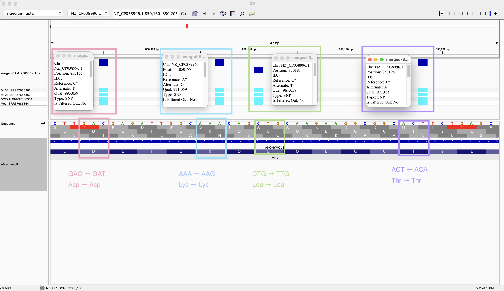

# Week 9 Assignment 

## Bioproject `PRJNA1439525`
This analysis uses sequencing data from NCBI BioProject [PRJNA1439525](https://www.ncbi.nlm.nih.gov/bioproject/PRJNA1439525), submitted by Okayama University, Japan. The original study investigated the emergence of linezolid resistance in vanA-positive, vancomycin-resistant *Enterococcus faecium* during clinical treatment. Serial isolates collected from a single patient were examined using antimicrobial susceptibility testing and whole-genome sequencing to investigate genetic changes associated with increasing resistance.

## Selected Data for this analysis

### Preparing the design file
Metadata were retrieved using the following command:
```
bio search -H --csv PRJNA1439525 > design.csv
```

The resulting `design.csv` was then modified to only include the four paired-end Illumina runs listed below. Oxford Nanopore runs were excluded from this workflow.

### Selected Data
| Isolate | Run accession | Experiment |
|---|---|---|
| V2271 | [SRR37686361](https://trace.ncbi.nlm.nih.gov/Traces/index.html?view=run_browser&acc=SRR37686361&display=metadata) | [SRX32564595](https://www.ncbi.nlm.nih.gov/sra/SRX32564595) |
| V131 | [SRR37686362](https://trace.ncbi.nlm.nih.gov/Traces/index.html?view=run_browser&acc=SRR37686362&display=metadata) | [SRX32564594](https://www.ncbi.nlm.nih.gov/sra/SRX32564594) |
| V121 | [SRR37686363](https://trace.ncbi.nlm.nih.gov/Traces/index.html?view=run_browser&acc=SRR37686363&display=metadata) | [SRX32564593](https://www.ncbi.nlm.nih.gov/sra/SRX32564593) |
| V93 | [SRR37686364](https://trace.ncbi.nlm.nih.gov/Traces/index.html?view=run_browser&acc=SRR37686364&display=metadata) | [SRX32564592](https://www.ncbi.nlm.nih.gov/sra/SRX32564593) |

The selected runs are recorded in `design.csv`, and output files are identified using `sample_alias` and `run_accession`.

## Analysis Workflow and Makefile Usage

The reference used by this workflow is assembly [GCF_009734005.1_ASM973400v2](https://www.ncbi.nlm.nih.gov/datasets/genome/GCF_009734005.1/). The reference FASTA and corresponding GFF annotation are downloaded from the URLs specified in the Makefile.

The analysis consists of the following steps:

1. Download and decompress the reference genome, and build `BWA` and `FASTA` indexes.
2. Extract up to the first `N` spots from each run using `fastq-dump`.
3. Align paired-end reads to the reference using `bwa mem`, then sort and index the resulting `BAM` files.
4. Generate alignment statistics using `samtools flagstat`.
5. Call variants separately for each run using `bcftools mpileup` and `bcftools call`, with `ploidy` set to `1`. 6. Normalize, sort, and index the VCFs, and generate variant statistics.
7. Perform joint variant calling using all selected BAMs to produce a multisample VCF.

Up to four runs are processed concurrently. Joint calling starts after all per-run analyses complete successfully. The `joint-call` target uses the per-run BAMs to generate `vcf/merged-BAM_250000.vcf.gz`. Despite its filename, this output is a multisample VCF, and the input BAMs remain separate, unchanged in the `bam` directory. 


### Running the complete workflow

From the directory containing `Makefile` and the filtered `design.csv`, run:
```
make
```

This is equivalent to:
```
make batch
```

By default, the workflow extracts up to the first 250,000 spots from each selected run. To increase the extraction limit:
```
make batch N=500000
```

To use a different design file:
```
make batch DESIGN=other_design.csv
```


### Individual Targets
| Target        | Function                                                                                                  |
| ------------- | --------------------------------------------------------------------------------------------------------- |
| `make batch` | Processes all runs in `design.csv`, then performs joint calling.                                               |
| `make all SRR=... SAMPLE_NAME=...` | Generates alignment statistics, an indexed per-run VCF, and VCF statistics for one run.                                               |
| `make genome` | Downloads and decompresses the reference genome FASTA file.                                               |
| `make gff` | Downloads and decompresses the reference annotation GFF file.                                               |
| `make fastq SRR=...`  | Downloads the first `N` spots from `SRR37686361` and separates the paired-end reads into two FASTQ files. |
| `make index`  | Builds the BWA index for the reference genome.                                                            |
| `make align SRR=... SAMPLE_NAME=...`  | Aligns the paired-end reads with `bwa mem`, then sorts and indexes the BAM file.                          |
| `make stats SRR=... SAMPLE_NAME=...`  | Generates a `samtools flagstat` report for the BAM file.                                                  |
| `make variants SRR=... SAMPLE_NAME=...`  | Calls variants from the BAM, normalizes and sorts the records, and creates a compressed VCF with a `.tbi` index.                                              |
| `make vcf-stats SRR=... SAMPLE_NAME=...`  | Generates a variant statistics report using `bcftools stats`.                                            |
| `make merge-vcf`  | Merges the four existing sample VCFs into `vcf/merged-VCF_$(N).vcf.gz` and creates an index.                                                    |
| `make joint-call`  | Jointly calls variants from the four existing sample BAMs, producing `vcf/merged-BAM_$(N).vcf.gz` and an index.                                                    |
| `make clean`  | Deletes the `fasta`, `fastq`, `bam`, and `vcf` directories, including downloaded data and generated results.                    |

The optional `merge-vcf` target produces `vcf/merged-VCF_$(N).vcf.gz`. It combines existing variant calls without re-examining the BAMs and is not required for joint calling.

### Processing a single run
For single-run targets (`all`, `align`, `stats`, `variants`, and `vcf-stats`), specify both SRR and SAMPLE_NAME on the command line:
```
make all SRR=SRR37686361 SAMPLE_NAME=V2271_SRR37686361 N=250000
```
The `fastq` target requires only `SRR`:
```
make fastq SRR=SRR37686361
```
Shared reference targets (`genome`, `gff`, and `index`) do not require sample-specific parameters.

If the inputs were generated with a nondefault extraction limit, specify the same `N` value when running individual targets:
```
make stats SRR=SRR37686361 SAMPLE_NAME=V2271_SRR37686361 N=500000
```

**When running `make` or `make batch`, these parameters are read from `design.csv` and passed automatically to each per-run analysis.**


## Visualizing in IGV

Set `fasta/efaecium.fasta` as the reference genome, then load: `vcf/merged-BAM_250000.vcf.gz` to locate jointly called variants and `gff/efaecium.gff` to identify nearby genes.

