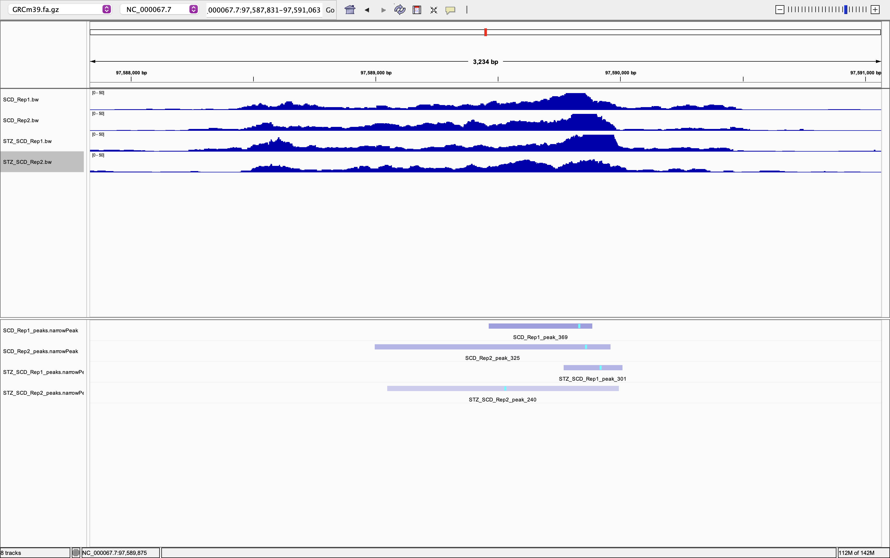
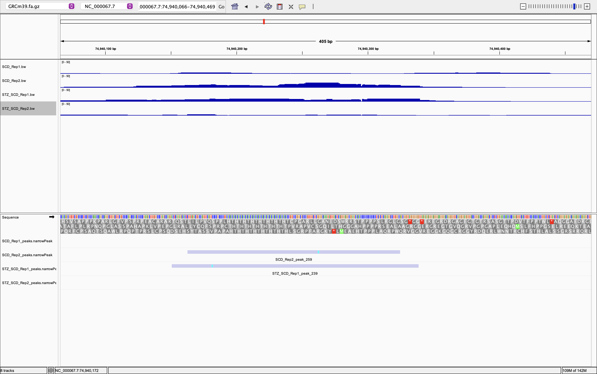

# Week 10 Assignment 

## Bioproject `PRJNA1032056`
This analysis uses sequencing data from NCBI BioProject [PRJNA1032056](https://www.ncbi.nlm.nih.gov/bioproject/?term=PRJNA1032056), submitted by Asan Medical Center. The organism studied is *Mus musculus* (C57BL/6J mice). The selected samples are used to compare chromatin accessibility between an SCD control condition and an SCD+STZ treatment condition. ATAC-seq identifies genomic regions of accessible chromatin, which can be represented by enrichment peaks.


## Selected Data for this analysis

### Preparing the design file
Metadata were retrieved using the following command:
```
bio search -H --csv PRJNA1032056 > design.csv
```

The resulting `design.csv` was then modified to only include the four paired-end Illumina runs listed below. Two biological replicates per condition are included, for a total of four samples. 

I added a sample column to `design.csv` and manually assigned descriptive sample names based on the information provided in the `sample_description` column. Then, the `sample_description` column was removed. These names distinguish the experimental conditions (SCD and SCD+STZ) and biological replicates, and are used to label the output files throughout the analysis.

| Condition | Sample | Run accession |
|---|---|---|
| SCD (control) | `SCD_Rep1` | [SRR26515793](https://trace.ncbi.nlm.nih.gov/Traces/?view=run_browser&acc=SRR26515793&display=metadata) |
| SCD (control) | `SCD_Rep2` | [SRR26515791](https://trace.ncbi.nlm.nih.gov/Traces/?view=run_browser&acc=SRR26515791&display=metadata) |
| SCD+STZ (treatment) | `STZ_SCD_Rep1` | [SRR26515789](https://trace.ncbi.nlm.nih.gov/Traces/?view=run_browser&acc=SRR26515789&display=metadata) |
| SCD+STZ (treatment) | `STZ_SCD_Rep2` | [SRR26515792](https://trace.ncbi.nlm.nih.gov/Traces/?view=run_browser&acc=SRR26515792&display=metadata) |


## Analysis Workflow and Makefile Usage
The reference genome is mouse assembly [GRCm39 (GCF_000001635.27)](https://www.ncbi.nlm.nih.gov/datasets/genome/GCF_000001635.27/). The reference FASTA and GFF annotation are downloaded from the URLs specified in the `Makefile`.

The `Makefile` was obtained from the course textbook, but I modified it to accommodate the ATAC-seq analysis workflow. Specifically, I adapted it to use the mouse reference genome (GRCm39), align paired-end reads using `bwa mem`, generate bigWig files using `bamCoverage`, and identify accessible chromatin regions using `MACS3`. I also configured the workflow to process multiple samples listed in `design.csv` using GNU Parallel.

The analysis consists of the following steps:

1. Download the mouse reference FASTA and GFF files, index the FASTA using `samtools faidx`, and index the GFF using `tabix`.
2. Build a reference index using `bwa index`.
3. Extract up to the first `N = 10000000` spots per sequencing run into paired FASTQ files using `fastq-dump --split-files`.
4. Align each sample separately to GRCm39 using `bwa mem`, sort the alignments using `samtools sort`, and index each BAM using `samtools index`.
5. Generate alignment statistics using `samtools flagstat`.
6. Generate a bigWig coverage track for each sample using `bamCoverage`.
7. Call accessible chromatin peaks independently for each sample using `macs3 callpeak` with paired-end BAM input (`-f BAMPE`), mouse genome size (`-g mm`), and a q-value cutoff of `0.01`.
8. Compare replicate peak patterns and chromatin accessibility signals in IGV.

To reduce processing time, the workflow uses at most the first 10 million spots from each run rather than the complete sequencing dataset. This subsampling may reduce sensitivity for weak peaks and should be considered when interpreting the results.

### Running the complete workflow

From the directory containing `Makefile` and `design.csv`, run:

```bash
make batch
```

The batch target processes all selected runs using GNU Parallel. The number of simultaneous samples is set by the `--jobs` option in the Makefile (for example, `--jobs 1` or `--jobs 2`).

### Individual Targets

| Target | Function |
|---|---|
| `make genome` | Downloads and indexes the reference FASTA and GFF files. |
| `make index` | Builds the BWA reference index. |
| `make fastq SRR=...` | Extracts paired-end FASTQ files for a sequencing run. |
| `make align SRR=... SAMPLE=...` | Aligns reads and generates indexed BAM and bigWig files. |
| `make peaks SRR=... SAMPLE=...` | Calls peaks for one sample using MACS3. |
| `make all SRR=... SAMPLE=...` | Runs reference preparation, alignment, coverage generation, and peak calling for one sample. |
| `make batch` | Processes all samples listed in `design.csv`. |
| `make clean`  | Deletes the `fasta`, `fastq`, and `bam` directories, including downloaded data and generated results.      

### Processing a single run

For example, to process one SCD+STZ biological replicate:

```bash
make SRR=SRR26515792 SAMPLE=STZ_SCD_Rep2 all
```

The expected sample-specific outputs include:

```text
fastq/SRR26515792_1.fastq
fastq/SRR26515792_2.fastq
bam/STZ_SCD_Rep2.bam
bam/STZ_SCD_Rep2.bam.bai
bw/STZ_SCD_Rep2.bw
peaks/STZ_SCD_Rep2_peaks.narrowPeak
```

When running `make batch`, the `run_accession` and `sample` values are read automatically from `design.csv`.

## Visualizing Peaks in IGV

Load the mouse GRCm39 reference genome into IGV, followed by the four sample-specific bigWig (`.bw`) tracks and MACS3 narrowPeak (`.narrowPeak`) files. Compare the two biological replicates within each condition using the same genomic coordinates. Where possible, use comparable bigWig display scales.

### Concordant peak region



In the region `NC_000067.7:97,587,831–97,591,063` (mouse chromosome 1), overlapping ATAC-seq peaks were observed between biological replicates within both experimental conditions. The bigWig tracks showed enrichment at similar genomic positions, and the MACS3 narrowPeak tracks confirmed overlapping peak regions.

### Discordant peak region



In the region `NC_000067.7:74,940,066–74,940,469` (mouse chromosome 1), peak detection differed between biological replicates in both experimental conditions. In the SCD condition, MACS3 detected a peak in Rep2 but not Rep1, whereas in the SCD+STZ condition, a peak was detected in Rep1 but not Rep2. The bigWig tracks also showed differences in ATAC-seq signal intensity between replicates.

