# Week 11 Assignment 

### Difference between UHR and HBR
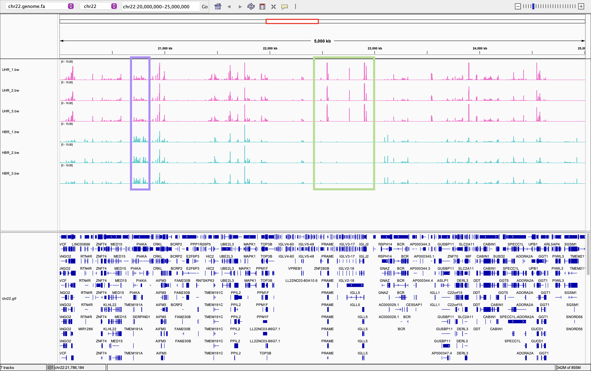

In the `chr22:20,000,000–25,000,000` region, UHR and HBR show different RNA-seq coverage patterns. Some regions have higher coverage in UHR (green box), while others have higher coverage in HBR (purple box). For example, UHR shows higher coverage around 22.5–23.0 Mb, whereas HBR shows higher coverage around 20.7–20.9 Mb. However, both sample types also share several coverage peaks, suggesting that some genes are expressed in both groups.

### Consistency of replicates
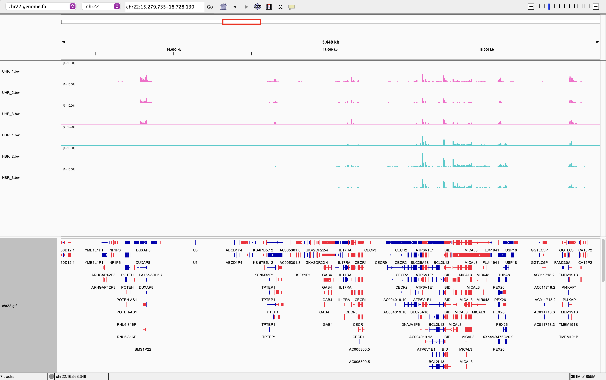
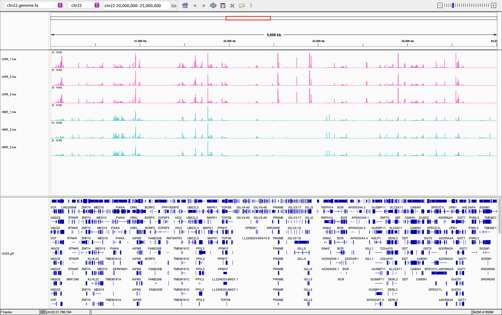
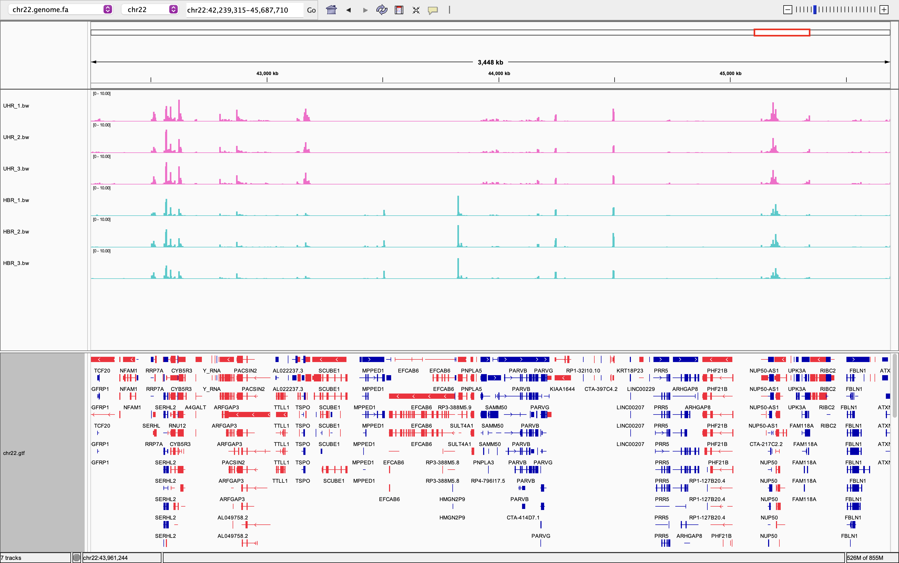

The replicates are highly consistent within each sample type. Across different regions of chromosome 22, the three UHR replicates show similar coverage patterns, and the three HBR replicates also show similar patterns. Most coverage peaks occur at the same genomic positions, although their heights vary slightly. Overall, the replicates show good reproducibility.

### VPREB1 is not expressed
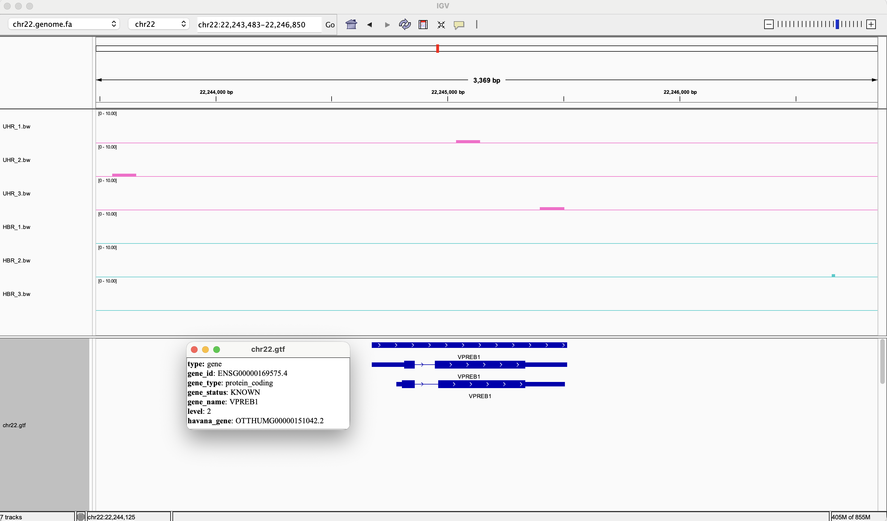

VPREB1 (`chr22:22,243,483–22,246,850`) shows little to no detectable RNA-seq coverage in all six samples. Although a few very small coverage peaks are present, there is no substantial coverage across the annotated gene region. This suggests that VPREB1 is not expressed or is expressed at a very low level in these samples.

### SEPT5 and MAKP1
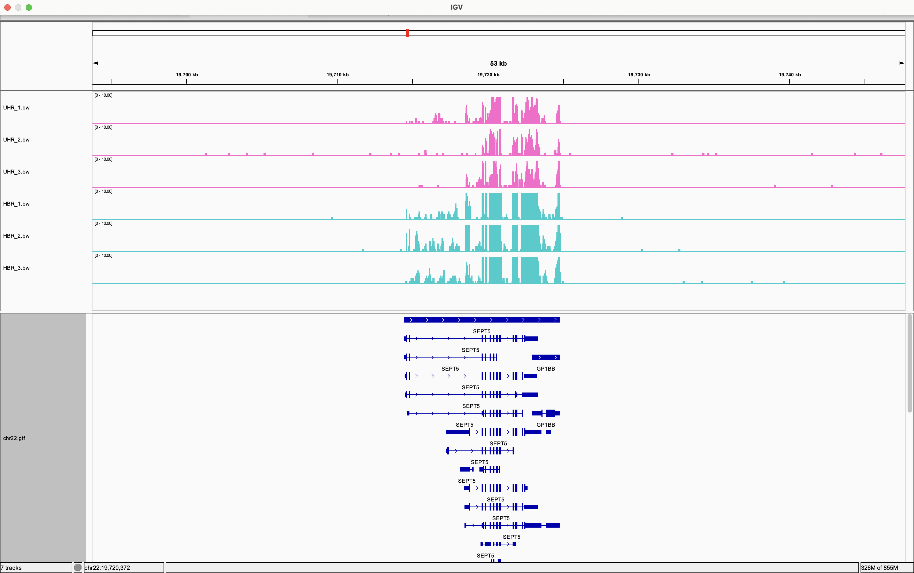

I initially identified SEPT5(`chr22:19,696,670-19,750,550`) as a strongly expressed gene because it showed high coverage peaks in all six samples. 

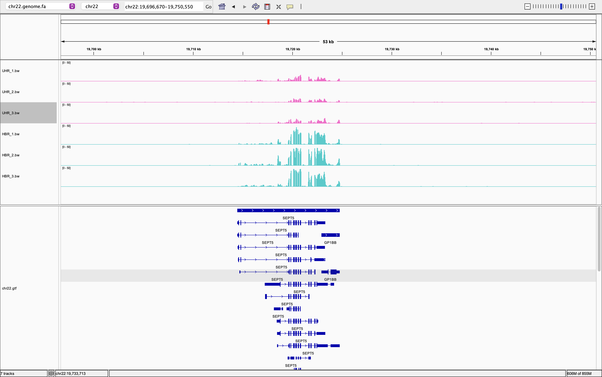

However, after adjusting the Y-axis scale from 0–10 to 0–50, I noticed that the coverage was much higher in HBR than in UHR.

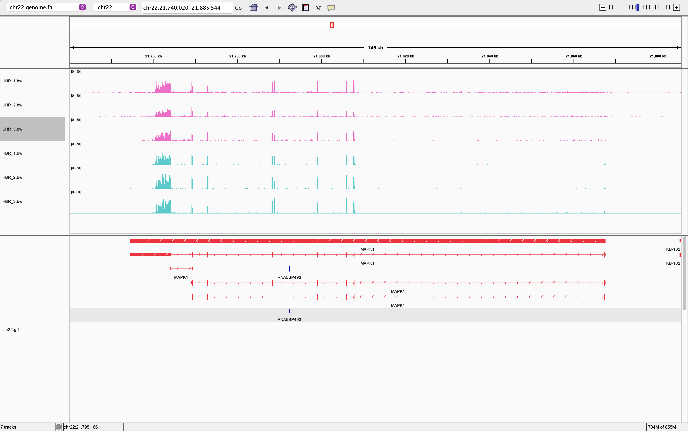

I then examined MAPK1 (`chr22:21,740,020-21,885,544`), which showed relatively high coverage in both sample types. 

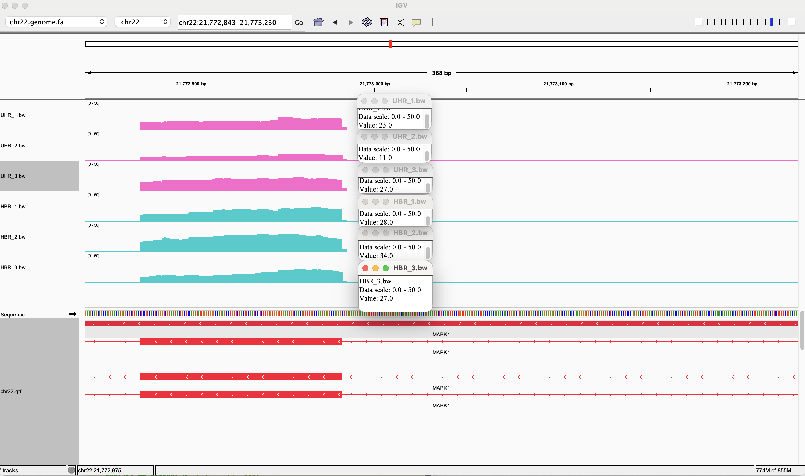

At approximately `chr22:21,772,843`, the coverage values were 23, 11, and 27 for the three UHR replicates, and 28, 34, and 27 for the three HBR replicates, respectively. The average coverage at this position was approximately 20.3 for UHR and 29.7 for HBR.

### EWSR1
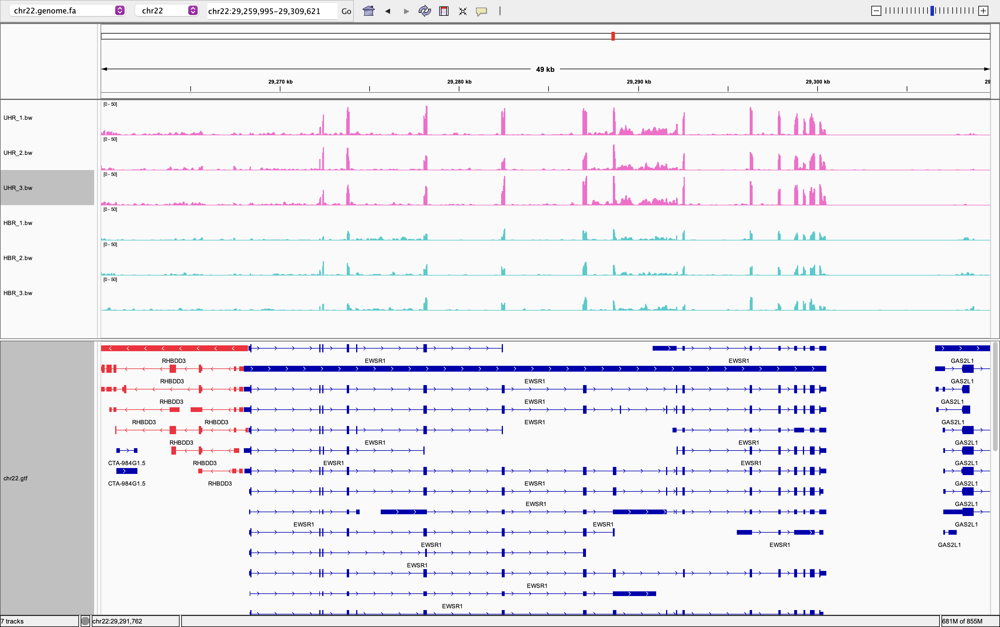

I examined the EWSR1 (`chr22:29,259,995-29,309,621`) gene, which has multiple annotated transcripts in the GTF file. RNA-seq coverage was observed across several annotated exons in both UHR and HBR samples, indicating that EWSR1 is expressed. However, many of the annotated transcripts share the same exons, making it difficult to determine exactly which isoforms are expressed based on coverage alone.

### SEPT5: expression is clearly different between the two samples

Earlier, SEPT5 shows a clear difference in RNA-seq coverage between UHR and HBR samples.

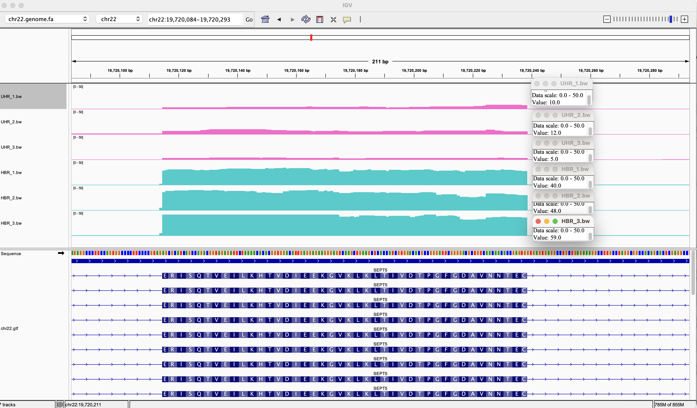

To estimate the fold change, I visually selected a region with one of the highest coverage peaks in SEPT5 and measured the coverage at the same genomic position across all six samples. At a selected exonic position around `chr22:19,720,270`, the coverage values were 10, 12, and 5 for UHR, and 40, 48, and 59 for HBR. The mean coverage was 9.0 for UHR and 49.0 for HBR, giving an estimated coverage fold change (HBR/UHR) of approximately 5.44. This is a local coverage-based estimate rather than an exact gene-level expression fold change.

SEPT5 appears to be upregulated in HBR relative to UHR, as all three HBR replicates show substantially higher coverage than the UHR replicates at the selected position. The same general pattern is also visible across several nearby exons.

I think that the observed difference in SEPT5 coverage is not simply a random fluctuation. All three HBR replicates consistently show higher coverage than the three UHR replicates, with no overlap between the groups at the selected position. Similar differences are also observed across nearby exonic regions. However, statistical differential expression analysis using normalized read counts would be required to confirm whether this difference is statistically significant.
