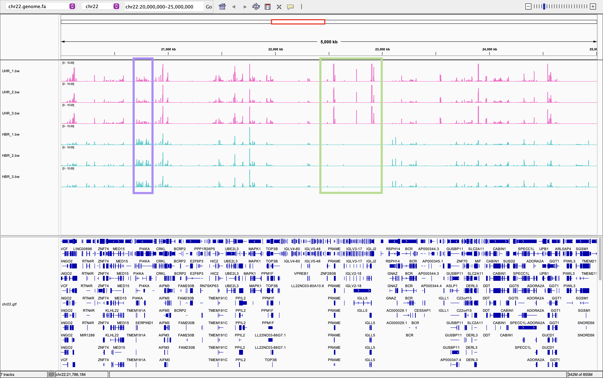
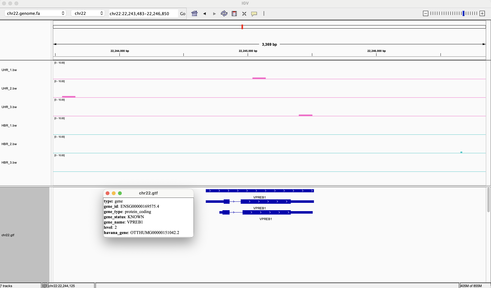
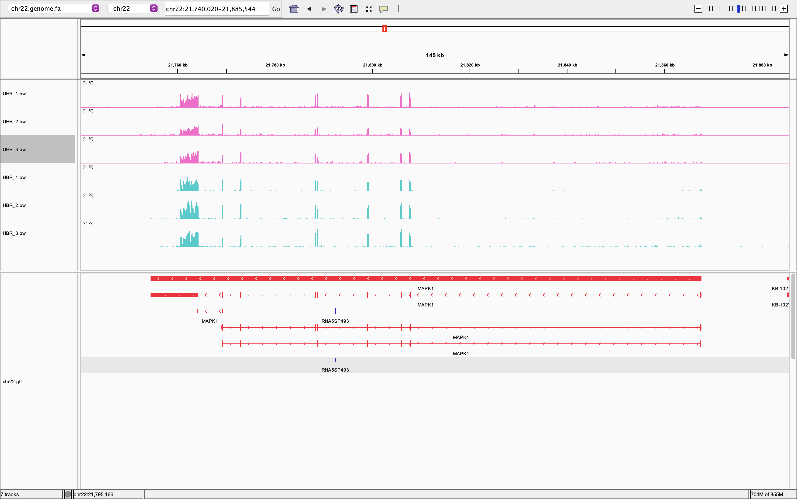

# Week 12 Assignment

## How to run the scripts 

###  Makefiles
Two Makefiles were downloaded from the BioStar Handbook to perform gene-level and transcript-level RNA-seq analysis.
- `gene_level.mk`: Makefile for genome-based RNA-seq analysis using HISAT2 and featureCounts.
- `transcript_level.mk`: Makefile for transcript-based quantification using Salmon.

The Makefiles were downloaded using the following commands:

```
curl -fsSL https://data.biostarhandbook.com/make/rnaseq.hisat.2026.mk > gene_level.mk
curl -fsSL https://data.biostarhandbook.com/make/rnaseq.salmon.2026.mk > transcript_level.mk
```

The downloaded Makefiles then have been slightly adjusted to ensure that all targets can be executed correctly. Counts were generated using the following commands:
```
make -f gene_level.mk batch
make -f transcript_level.mk batch
```


### `src/` 

Contains R scripts for combining and summarizing gene and transcript counts, analyzing gene expression across sample groups, and comparing gene-level expression estimates from featureCounts and Salmon.

#### 1. `combine_gene_counts.R`
Combines per-sample featureCounts files into a single gene count matrix and adds gene names using GTF annotations.
- Input: `design.csv`, `counts/*.txt`, `gtf/chr22.gtf`
- Output: `results/gene_counts.csv` — a gene count matrix containing gene IDs, gene names, and raw counts for each sample.

#### 2. `summarize_gene_counts.R`
Summarizes gene expression across sample groups by calculating mean gene counts, identifying expressed and non-expressed genes, and categorizing genes into expression-level bins.

- Input: `results/gene_counts.csv`, `design.csv`
- Output:
  - `results/group_mean_counts.csv` — Mean gene counts for each group.
  - `results/expression_summary.csv` — Number of expressed and non-expressed genes per group.
  - `results/expression_bins.csv` — Distribution of genes across expression-level bins.
- Terminal output:
```
=== Gene Expression Summary ===
 group not_expressed expressed total_genes
   HBR           737       634        1371
   UHR           601       770        1371

=== Expression Level Distribution ===
 group expression_level gene_count
   HBR           (0, 1]        157
   HBR          (1, 10]        165
   HBR         (10, 50]        115
   HBR        (50, 100]         85
   HBR       (100, 500]         98
   HBR      (500, 1000]         11
   HBR            >1000          3
   UHR           (0, 1]        236
   UHR          (1, 10]        205
   UHR         (10, 50]        105
   UHR        (50, 100]         72
   UHR       (100, 500]        133
   UHR      (500, 1000]         14
   UHR            >1000          5
```

#### 3. `compare_transcript_counts.R`

Combines Salmon-estimated transcript counts across samples into a single transcript count matrix and adds gene annotations using a GTF file.

- Input:*`design.csv`, `counts/*/quant.sf`, `gtf/chr22.gtf`
- Output: `results/transcript_counts.csv` — A transcript count matrix containing transcript IDs, gene IDs, gene names, and estimated counts for each sample.

#### 4. `summarize_transcript_counts.R`

Aggregates transcript-level counts into gene-level counts by summing transcripts belonging to the same gene using GTF annotations.

- Input: `results/transcript_counts.csv`, `gtf/chr22.gtf`
- Output: `results/gene_counts_from_transcripts.csv` — A gene count matrix containing gene IDs, gene names, and summed transcript counts for each sample.

#### 5. `compare_gene_expression.R`

Compares gene-level counts from featureCounts and Salmon-derived transcript counts across sample groups by calculating absolute and relative expression differences.

- Input: `results/gene_counts.csv`, `results/gene_counts_from_transcripts.csv`, `design.csv`
- Output: `results/gene_expression_errors.csv` — Per-gene expression comparisons, including group mean counts and absolute and relative errors.
- Terminal output:
```
                  HBR  UHR
genes            1369 1369
mean abs error   2.40 4.91
median abs error 0.00 0.00
mean rel error   0.23 0.30
median rel error 0.00 0.00
               gene     name group genome transcript abs_error rel_error
  ENSG00000211677.2    IGLC2   UHR 832.67    2678.49   1845.82      1.05
 ENSG00000100129.17    EIF3L   UHR 553.33    1005.56    452.23      0.58
  ENSG00000240972.1      MIF   UHR  54.00     468.22    414.22      1.59
  ENSG00000211679.2    IGLC3   UHR 639.33     963.38    324.05      0.40
  ENSG00000241360.1     PDXP   HBR   3.33     242.19    238.85      1.95
 ENSG00000100014.19  SPECC1L   HBR  71.33     292.06    220.72      1.21
 ENSG00000100014.19  SPECC1L   UHR 112.67     330.67    218.00      0.98
  ENSG00000211666.2 IGLV2-14   UHR  15.67     183.33    167.67      1.69

Per-gene errors saved to results/gene_expression_errors.csv
```

## Consistency with Week11 Findings
Screenshots are from Week 11.


To verify the expression pattern observed in IGV last week, I checked  PRAME (in green box) gene using:
```
xan filter 'eq(name, "PRAME")' results/gene_counts.csv
```
Output:
```
gene,name,HBR_1,HBR_2,HBR_3,UHR_1,UHR_2,UHR_3
ENSG00000185686.17,PRAME,0,0,0,814,464,600
```
The results are consistent with last week's IGV observations. PRAME showed higher expression in UHR (814, 464, and 600 counts) and no expression in HBR (0 counts across all three samples), matching the expression pattern observed in IGV.


I also checked the gene counts for VPREB1, which showed no visible expression in last week's IGV observations:
```
gene,name,HBR_1,HBR_2,HBR_3,UHR_1,UHR_2,UHR_3
ENSG00000169575.4,VPREB1,0,0,0,1,0,1
```
This is consistent with last week's IGV observations. VPREB1 showed little to no expression, with zero counts in all HBR samples and only 1 count in two UHR samples.


I also checked the gene counts for MAPK1, which showed high coverage in HBR and UHR last week:
```
gene,name,HBR_1,HBR_2,HBR_3,UHR_1,UHR_2,UHR_3
ENSG00000100030.14,MAPK1,738,950,900,834,497,663
```
This is also onsistent with last week as MAPK1 showed relatively similar expression levels in both groups, with slightly higher counts in HBR than in UHR.

